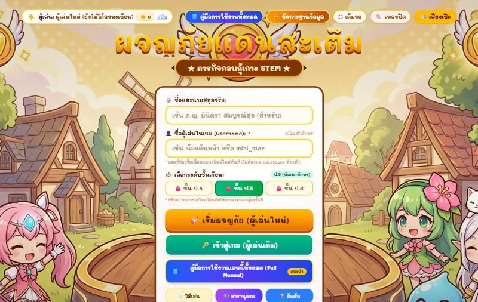
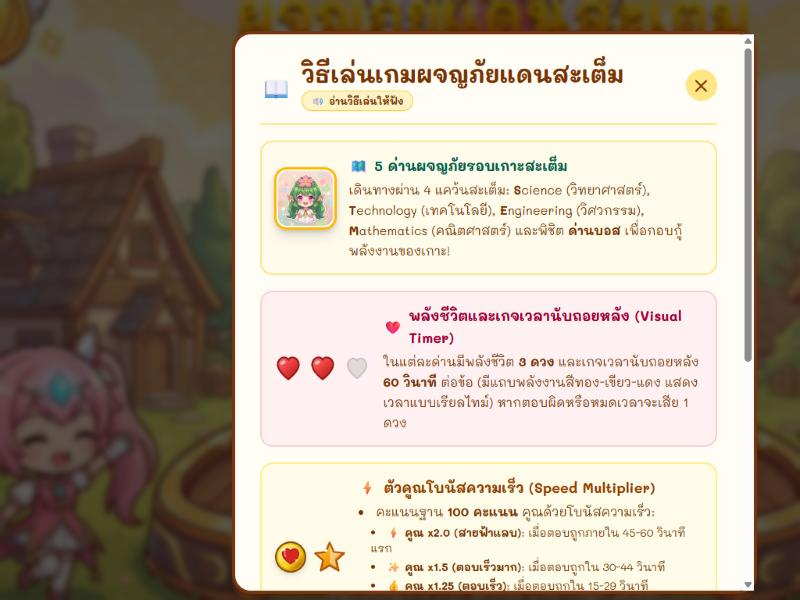

# ผจญภัยแดนสะเต็ม: ภารกิจกอบกู้เกาะ STEM

เกมการศึกษาบูรณาการ STEM แบบ 2D สไตล์การ์ตูนชิบิ สำหรับนักเรียนชั้น ป.4–ป.6
ผจญภัย 5 ด่าน พร้อมแบบทดสอบก่อนเรียน–หลังเรียน ระบบคะแนน ดาว เกียรติบัตร เสียงอ่านโจทย์ภาษาไทย และคำอธิบายเฉลยทุกข้อ

**เล่นได้ทันทีที่:** https://galaxycodep.github.io/STEM-EDUCATION-GAMEX/

## ตัวอย่างหน้าจอ

| หน้าแรกและลงทะเบียนผู้เล่น | วิธีเล่นเกม (มีเสียงอ่านภาษาไทย) |
| :---: | :---: |
|  |  |

---

## สารบัญ

- [เล่นออนไลน์ (ไม่ต้องติดตั้ง)](#เล่นออนไลน์-ไม่ต้องติดตั้ง)
- [ติดตั้งและรันบนเครื่องตัวเอง](#ติดตั้งและรันบนเครื่องตัวเอง)
- [วิธีใช้งานสำหรับนักเรียน](#วิธีใช้งานสำหรับนักเรียน)
- [วิธีใช้งานสำหรับครู / ผู้ดูแล](#วิธีใช้งานสำหรับครู--ผู้ดูแล)
- [การเก็บข้อมูล](#การเก็บข้อมูล)
- [เชื่อมต่อฐานข้อมูล MySQL (ไม่บังคับ)](#เชื่อมต่อฐานข้อมูล-mysql-ไม่บังคับ)
- [นำไปเผยแพร่บน GitHub Pages ของตัวเอง](#นำไปเผยแพร่บน-github-pages-ของตัวเอง)
- [โครงสร้างโปรเจกต์](#โครงสร้างโปรเจกต์)
- [ปัญหาที่พบบ่อย](#ปัญหาที่พบบ่อย)

---

## เล่นออนไลน์ (ไม่ต้องติดตั้ง)

เปิดลิงก์ด้านบนด้วยเบราว์เซอร์รุ่นใหม่ (Chrome, Edge, Safari, Firefox) บนคอมพิวเตอร์ แท็บเล็ต หรือมือถือ

- ต้องต่ออินเทอร์เน็ตเพื่อโหลดเกมและเพื่อใช้เสียงอ่านภาษาไทย
- ข้อมูลผู้เล่นเก็บในเบราว์เซอร์ของเครื่องนั้น ดูรายละเอียดที่หัวข้อ [การเก็บข้อมูล](#การเก็บข้อมูล)

## ติดตั้งและรันบนเครื่องตัวเอง

### สิ่งที่ต้องมี

- [Node.js](https://nodejs.org/) เวอร์ชัน 20 ขึ้นไป (มี `npm` มาด้วย)
- [Git](https://git-scm.com/) (หรือดาวน์โหลดเป็นไฟล์ ZIP จากหน้า GitHub แทนได้)

### ขั้นตอน

1. ดาวน์โหลดโค้ด

   ```bash
   git clone https://github.com/GalaxyCodeP/STEM-EDUCATION-GAMEX.git
   ```

   ```bash
   cd STEM-EDUCATION-GAMEX
   ```

2. ติดตั้งไลบรารี

   ```bash
   npm install
   ```

3. รันเกมในโหมดพัฒนา

   ```bash
   npm run dev
   ```

4. เปิดเบราว์เซอร์ไปที่ http://localhost:3000

เครื่องอื่นในวง Wi-Fi/LAN เดียวกันเข้าเล่นได้ที่ `http://<IP ของเครื่องที่รัน>:3000`

### คำสั่งทั้งหมด

| คำสั่ง | ใช้ทำอะไร |
| --- | --- |
| `npm run dev` | รันเกมในโหมดพัฒนาที่พอร์ต 3000 แก้โค้ดแล้วหน้าเว็บอัปเดตทันที |
| `npm run build` | สร้างไฟล์เว็บพร้อมใช้งานจริงลงโฟลเดอร์ `dist/` |
| `npm run preview` | เปิดดูผลลัพธ์ใน `dist/` หลัง build |
| `npm run server` | รัน API เซิร์ฟเวอร์ (Node) ที่พอร์ต 3001 สำหรับโหมด MySQL |
| `npm run lint` | ตรวจชนิดข้อมูล TypeScript |

ไม่ต้องตั้งค่าไฟล์ `.env` เพื่อเล่นเกม ตัวเกมไม่ได้เรียกใช้ค่าใน `.env.example`

## วิธีใช้งานสำหรับนักเรียน

1. **ลงทะเบียน** – กรอกชื่อ-นามสกุลจริง (ใช้พิมพ์บนเกียรติบัตร) ชื่อผู้เล่นในเกม เลือกระดับชั้น ป.4 / ป.5 / ป.6 แล้วกด "เริ่มผจญภัย (ผู้เล่นใหม่)"
   ผู้เล่นเดิมกด "เข้าสู่ระบบ (ผู้เล่นเดิม)"
2. **ทำแบบทดสอบก่อนเรียน** (Pretest)
3. **เลือกด่านจากแผนที่** – มี 5 ด่าน ต้องผ่านด่านก่อนหน้าเพื่อปลดล็อกด่านถัดไป
4. **ตอบคำถามในด่าน** – กดปุ่มรูปลำโพงเพื่อฟังเสียงอ่านโจทย์และตัวเลือก หลังตอบจะมีคำอธิบายเฉลย
5. **ทำแบบทดสอบหลังเรียน** (Posttest) เมื่อผ่านครบทุกด่าน แล้วรับเกียรติบัตร

ปุ่มบนหน้าแรก:

- **วิธีเล่นเกม** – สรุปกติกา พร้อมเสียงอ่าน
- **คู่มือการใช้งาน** – คู่มือฉบับเต็ม 8 บท
- **สารานุกรมสะเต็ม** – ความรู้และตราเกียรติยศที่สะสมได้
- **ตารางอันดับ** – คะแนนสูงสุดของผู้เล่นในเครื่องนี้

## วิธีใช้งานสำหรับครู / ผู้ดูแล

กดปุ่ม "🔒 จัดการฐานข้อมูล" ที่มุมขวาบนของหน้าแรก แล้วใส่รหัส 6 หลัก

- **รหัสเริ่มต้น:** `121212`
- แดชบอร์ดใช้ดูรายชื่อผู้เล่น คะแนน ความก้าวหน้า รายงานผลการเรียนรู้ จัดการคำถาม และตั้งค่าการเก็บข้อมูล
- ส่งออกข้อมูลได้เป็น CSV, SQL และ JSON และกู้คืนจากไฟล์สำรอง JSON ได้

> **ควรเปลี่ยนรหัสก่อนนำไปใช้จริง** แก้เลข `121212` ทั้งสองจุดให้ตรงกัน คือ
> `src/components/AdminPasscodeModal.tsx` และฟังก์ชัน `verifyAdminPasscode` ใน `src/services/database.ts` แล้ว build ใหม่
>
> รหัสนี้ตรวจสอบในเบราว์เซอร์เท่านั้น ผู้ที่เปิดดูโค้ดของหน้าเว็บจะหารหัสเจอได้ จึงกันได้แค่การกดเข้าโดยไม่ตั้งใจ ไม่ใช่ระบบรักษาความปลอดภัยจริง

## การเก็บข้อมูล

ค่าเริ่มต้นคือโหมด **LocalStorage**: ข้อมูลผู้เล่น คะแนน และความก้าวหน้าเก็บในเบราว์เซอร์ของแต่ละเครื่อง

- แต่ละเครื่อง (และแต่ละเบราว์เซอร์) มีข้อมูลแยกกัน ไม่แชร์ข้ามเครื่อง
- ข้อมูลหายถ้าล้างข้อมูลเว็บไซต์ของเบราว์เซอร์ หรือเล่นในโหมดไม่ระบุตัวตน
- แนะนำให้ครูกด "สำรองฐานข้อมูล JSON" ในแดชบอร์ดผู้ดูแลเป็นระยะ

ถ้าต้องการรวมข้อมูลของทั้งห้องไว้ที่เดียว ให้ใช้โหมด MySQL ด้านล่าง

## เชื่อมต่อฐานข้อมูล MySQL (ไม่บังคับ)

โหมดนี้ต้องมีเครื่องแม่ข่ายที่รันฐานข้อมูลและ API **ใช้กับเว็บบน GitHub Pages ไม่ได้** เพราะ GitHub Pages ให้บริการเฉพาะไฟล์เว็บ และเบราว์เซอร์จะบล็อกการเรียก `http://localhost` จากหน้า `https://`
ให้รันเกมบนเครื่องตัวเองตามหัวข้อ [ติดตั้งและรันบนเครื่องตัวเอง](#ติดตั้งและรันบนเครื่องตัวเอง)

### 1. สร้างฐานข้อมูล

1. ติดตั้ง [XAMPP](https://www.apachefriends.org/) แล้วกด Start ที่ **MySQL** (และ **Apache** ถ้าจะใช้ API แบบ PHP)
2. เปิด http://localhost/phpmyadmin เลือกแท็บ **Import**
3. เลือกไฟล์ `stem_education_db.sql` แล้วกด **Import**

สคริปต์จะสร้างฐานข้อมูลชื่อ `stem_education_db` พร้อมตารางทั้งหมด

### 2. เลือก API อย่างใดอย่างหนึ่ง

**แบบ A – Node.js**

```bash
npm run server
```

API จะอยู่ที่ `http://localhost:3001/api`
ค่าเชื่อมต่อเริ่มต้นตรงกับ XAMPP (`root` ไม่มีรหัสผ่าน) ถ้าต่างออกไปให้ตั้งตัวแปรสภาพแวดล้อมก่อนรัน: `DB_HOST`, `DB_PORT`, `DB_USER`, `DB_PASSWORD`, `DB_NAME`, `PORT`

**แบบ B – PHP บน XAMPP**

1. คัดลอกไฟล์ `api/index.php` ไปไว้ที่ `C:\xampp\htdocs\stem-api\`
2. API จะอยู่ที่ `http://localhost/stem-api/index.php`

ตัวแปรสภาพแวดล้อมที่รองรับ: `DB_HOST`, `DB_PORT`, `DB_NAME`, `DB_USER`, `DB_PASS`

### 3. ตั้งค่าในเกม

1. เข้าแดชบอร์ดผู้ดูแล ไปที่ส่วนตั้งค่าการเก็บข้อมูล
2. เลือก **MySQL / XAMPP**
3. ใส่ URL ของ API ตามแบบที่เลือก แล้วกดทดสอบการเชื่อมต่อ

## นำไปเผยแพร่บน GitHub Pages ของตัวเอง

1. Fork repo นี้ หรือ push โค้ดขึ้น repo ของตัวเอง
2. ไปที่ **Settings → Actions → General → Workflow permissions** เลือก **Read and write permissions**
3. push เข้า branch `main` – workflow ใน `.github/workflows/deploy.yml` จะ build แล้วส่งผลลัพธ์ไปที่ branch `gh-pages`
4. ไปที่ **Settings → Pages** เลือก Source เป็น **Deploy from a branch** และ branch เป็น `gh-pages` (โฟลเดอร์ `/ (root)`)
5. รอสักครู่ เว็บจะอยู่ที่ `https://<ชื่อผู้ใช้>.github.io/<ชื่อ repo>/`

ถ้า build เองในเครื่องเพื่อวางใต้ sub-path ต้องกำหนด `BASE_PATH` ให้ตรงกับชื่อ repo:

```powershell
$env:BASE_PATH = '/<ชื่อ repo>/'; npm run build
```

```bash
BASE_PATH=/<ชื่อ repo>/ npm run build
```

ถ้าวางที่ราก (root) ของโดเมน ไม่ต้องกำหนด `BASE_PATH`
ผลลัพธ์ใน `dist/` เป็นไฟล์เว็บล้วน นำไปวางบนโฮสติ้งใดก็ได้ (Netlify, Vercel, Apache, Nginx ฯลฯ)

## โครงสร้างโปรเจกต์

```
├── index.html                 หน้า HTML หลัก
├── vite.config.ts             ตั้งค่า Vite (รวม BASE_PATH สำหรับ sub-path)
├── server.ts                  API เซิร์ฟเวอร์ Node/Express สำหรับโหมด MySQL
├── api/index.php              API แบบ PHP สำหรับ XAMPP
├── stem_education_db.sql      สคริปต์สร้างฐานข้อมูล MySQL
├── public/assets/             รูปภาพของเกม
└── src/
    ├── App.tsx                ตัวควบคุมหน้าจอทั้งหมด
    ├── components/            หน้าจอและหน้าต่างต่าง ๆ ของเกม
    ├── data/                  คำถามแต่ละด่าน แบบทดสอบ และสารานุกรม
    ├── services/              การเก็บข้อมูลและการเชื่อมต่อฐานข้อมูล
    └── utils/                 เสียงประกอบ เสียงอ่าน การเข้ารหัส ฯลฯ
```

แก้ไขหรือเพิ่มคำถามได้ที่ `src/data/questions.ts` และ `src/data/pretestQuestions.ts`

เทคโนโลยีที่ใช้: React 19, TypeScript, Vite, Tailwind CSS 4, Motion

## ปัญหาที่พบบ่อย

**ไม่มีเสียงอ่าน หรือเสียงอ่านเงียบ**
เสียงอ่านภาษาไทยดึงจากบริการเสียงของ Google Translate จึงต้องต่ออินเทอร์เน็ต และเครือข่ายต้องไม่บล็อก `translate.google.com`
ถ้าใช้บริการนี้ไม่ได้ เกมจะใช้เสียงภาษาไทยที่ติดตั้งในเครื่องแทน ถ้าเครื่องไม่มีเสียงภาษาไทย เกมจะไม่อ่าน
บน Windows เพิ่มเสียงไทยได้ที่ Settings → Time & language → Speech → Add voices

**แก้โค้ดแล้วหน้าเว็บยังเป็นแบบเดิม**
กด `Ctrl + F5` เพื่อโหลดใหม่โดยไม่ใช้แคช

**รูปภาพไม่ขึ้นหลังนำไปวางบนโฮสต์**
เกิดจาก `BASE_PATH` ไม่ตรงกับ path ที่วางเว็บ ให้ build ใหม่ตามหัวข้อด้านบน

**โหมด MySQL เชื่อมต่อไม่ได้**
ตรวจว่าเปิด MySQL ใน XAMPP แล้ว Import ไฟล์ `stem_education_db.sql` แล้ว และ `npm run server` (หรือ Apache) กำลังทำงานอยู่
ทดสอบ API แบบ Node ได้ที่ http://localhost:3001/api/health

**ข้อมูลผู้เล่นหาย**
โหมด LocalStorage ผูกกับเบราว์เซอร์และเครื่อง ตรวจว่าเปิดด้วยเบราว์เซอร์เดิม ไม่ได้ใช้โหมดไม่ระบุตัวตน และไม่ได้ล้างข้อมูลเว็บไซต์
